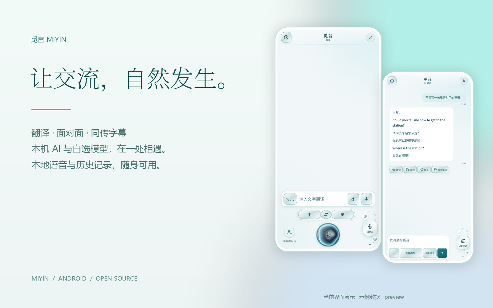
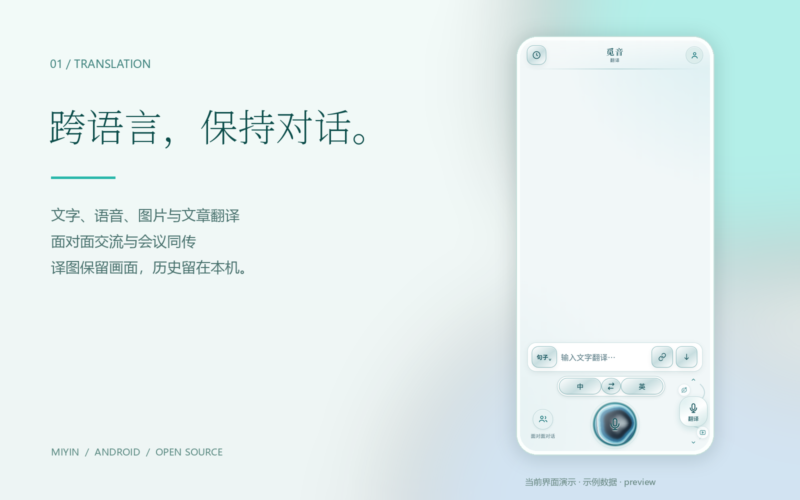
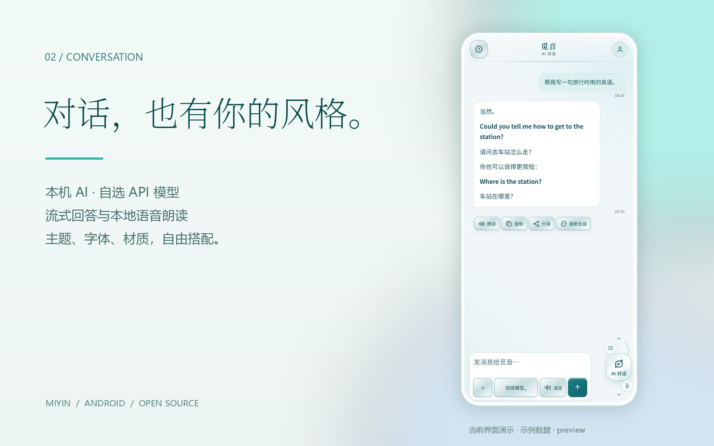

<p align="center"></p>

<h1 align="center">觅音 · Miyin</h1>
<p align="center">让交流，自然发生。<br>以本地能力为基础的 Android 翻译、同传与 AI 对话应用。</p>
<p align="center">
<a href="LICENSE"></a>


</p>
<p align="center"><a href="https://github.com/sun2006-xin/miyin-mobile/releases/latest">下载体验</a> · <a href="docs/README.md">开发与设计记录</a> · <a href="https://github.com/sun2006-xin/miyin-mobile/issues">问题反馈</a></p>

Miyin is an Android app for translation, live captions and AI conversations,
with bundled on-device speech and chat models. This is a preview release;
device compatibility and language quality are still being improved.

## 下载与安装

安装包统一放在 **[GitHub Releases](https://github.com/sun2006-xin/miyin-mobile/releases)**，源码仓库不保存 APK。
当前公开候选为 **1.6.0-preview+68**。完整包约 **2.23 GB**，保留本机 AI、视觉与离线语音资源。

GitHub Release 单文件必须小于 2 GiB，因此完整 APK 分为两个文件：

1. 下载 `.apk.part1`、`.apk.part2`，保持文件名并放在同一文件夹。
2. Windows 用户下载同页 `Merge-APK-Windows.cmd`，运行后合并并自动核对 SHA-256。
3. 将得到的 `.apk` 传入 Android 手机安装。手机直接下载需用支持分割合并的文件工具；分卷本身不能安装。

发布页同时提供 `INSTALL-README.txt`、`DOWNLOAD-MANIFEST.json` 和 `SHA256SUMS.txt`。
需支持 **arm64-v8a** 的 Android 手机。建议为安装及首次准备模型预留 **10 GB**；这是保守建议，不是已测出的最低要求。
当前使用测试签名，后续固定发行签名可能影响覆盖升级，请保留需要的导出文件。

## 功能

| 场景 | 已实现能力 |
| --- | --- |
| 翻译 | 文字、语音、原图文字覆盖翻译、文章对照与本机历史 |
| 面对面 | 双向交流、识别原文与译文、语音播报 |
| 视频与会议 | 双声源同传、悬浮字幕、字幕历史及双方有声 MP4 录屏 |
| AI 对话 | 内置本机模型、自选 API 模型、流式回答、图片附件、上下文与会话历史 |
| 本地语音 | 中英流式识别、多语言识别、本地多语言语音合成与音色选择 |
| 联网能力 | 搜索、公开网页读取和可打开的来源链接，受网络与服务可用性影响 |
| 觅音外观 | 主题、按钮材质、按压反馈、字体和 AI 球体自由搭配 |

<p align="center"></p>
<p align="center"></p>

宣传图为当前页面渲染与示例数据，不代表特定模型的回答质量或速度保证。

## 本地与联网的边界

随包 ASR、TTS 和本机聊天模型在手机运行，语音资源不要求用户另去网页寻找。
选择外部聊天模型时，请求会发送给用户配置的服务商，其费用与隐私政策分别适用。
额外离线翻译语言包由 Google ML Kit 在应用内下载；搜索和网页读取需要联网。
ML Kit SDK 还可能获取更新、发送性能和使用情况指标，因此本地推理不等于整个应用绝不联网。
历史和录制文件保存在本机；导出到手机公共目录的文件需另行管理。详见[隐私说明](PRIVACY.md)。

## 当前限制

- 主要真机验证设备为 OPPO PEHM00 / Android 12，其他品牌与逐语种质量仍需反馈。
- 首次准备、首次英文朗读和较长回答仍可能等待；识别与翻译准确率受口音、环境和模型影响。
- 某些 App 禁止系统音频捕获；录屏和麦克风需要 Android 授权。
- preview68 更换中英混读发音前端，自动化与合成检查已通过，仍需扩大听感验收。
- 手机 Agent 自动操作尚未完成；iOS 工程存在不代表 iOS 语音和媒体链路已验收。
- 旧实验 APK 只作开发留档，不建议作为当前体验入口；历史组件许可与当前版不同。

## 构建

使用 **Git + Git LFS** 克隆，只下载源码 ZIP 不等于取得模型内容：

```sh
git lfs install
git clone https://github.com/sun2006-xin/miyin-mobile.git
cd miyin-mobile
git lfs pull
cd app/miyin
flutter pub get
flutter build apk --release --target-platform android-arm64
```

已使用 Flutter **3.47.2** 与项目锁定依赖构建。独立目录构建记录见
[开源准备记录](docs/release/open-source-preflight-2026-11-03.md)；
该轮使用本机 LFS 对象和依赖缓存，不能代替远程下载或空缓存构建验证。
工具链和目录结构见[应用说明](app/miyin/README.md)。

## 参与开发

当前应用在 `app/miyin/`。Flutter 外壳承载随包页面，Android 适配层负责权限、音频、录屏和原生模型运行。
`main` 为统一公开分支，版本通过 tag 和 Release 留存。

- [贡献说明](CONTRIBUTING.md)：构建、修改与提交检查。
- [文档索引](docs/README.md)：当前规范与历史试验分开阅读。
- [更新记录](CHANGELOG.md)：版本演进。
- [安全说明](SECURITY.md)：报告前移除密钥和私人数据。

## 许可

觅音自有源码采用 **[Apache-2.0](LICENSE)**，可学习、修改、商用和再分发，须遵守许可要求。另见 [NOTICE](NOTICE)。
**第三方模型、字体、词典、SDK 与原生库保留各自许可，并非全部采用 Apache-2.0。**
例如 Supertonic 模型使用 OpenRAIL-M，含使用限制。再分发前请阅读
[第三方声明](app/miyin/THIRD_PARTY_NOTICES.md)及随包完整文本。
